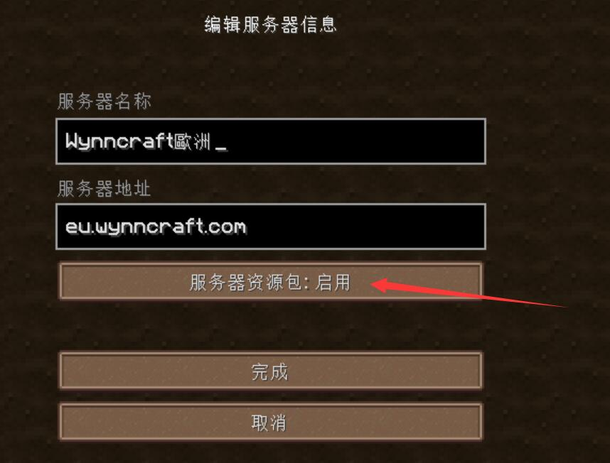

:::warning 观前提醒
这篇文章会把读者当做在大陆范围内有一些Minecraft游戏基础的玩家来看待

如果你在此之前没有任何Minecraft游戏经验，甚至是专门为了这个服务器购买的Minecraft

那么你可能会对这篇文章里面的专有名词存在一些不解。

欢迎向群友提问，但是还是得注意一下：这个服务器并不怎么适合零经验的玩家

建议先从生存模式开始入手`:)`
:::

:::tip
这篇文章的目的是介绍开始游戏前需要作何准备
:::

首先你需要注意的是，这个服务器是一个**MMORPG服务器**

和生存模式不同，这个服务器并不包含任何原版生存的元素。

何谓MMORPG？你可以查询一下[百度百科](https://baike.baidu.com/item/%E5%A4%A7%E5%9E%8B%E5%A4%9A%E4%BA%BA%E5%9C%A8%E7%BA%BF%E8%A7%92%E8%89%B2%E6%89%AE%E6%BC%94%E6%B8%B8%E6%88%8F/1735953?fr=ge_ala)

那么，在开始游玩之前，你需要做如下准备：

## 游戏加速器
这是最为重要的。

Wynncraft的服务器位于加拿大及各区域节点，大陆直接裸连会出现非常严重的丢包现象。

这里比较推荐以下两款加速器：

+ **AK加速器**：亚服，加速香港节点，日常使用首选
+ **VK加速器**：欧服 / 美服，加速对应区服，在对应服务器可用

请注意：**全局VPN并不能代替加速器。**

## 客户端与模组

游戏版本统一推荐 **`1.21.11`**（服务器准入 `1.20.5+`，Wynntils 最新版本持续维护在 `1.21.11`）。

启动器推荐使用 **`PCL2`** 或 **`HMCL`** 启动器，直接在启动器内创建 `1.21.11`（Fabric）客户端即可。

模组方面，**仅需安装 `Wynntils` 这一个 MOD 即可，同时下载必要的 `Fabric API`**（若想自行加装 Sodium 等优化模组可量力而行，但不要使用违规外挂模组）。

>什么是Wynntils？

Wynntils是一个由玩家群体自行制作的专门用于大幅提升Wynncraft游戏体验的MOD，包含了游戏地图、装备鉴定度显示、特色HUD等多种实用功能。

[Wynntils 下载地址](https://modrinth.com/mod/wynntils/)

[Fabric API 下载地址](https://modrinth.com/mod/fabric-api)

## 汉化

服务器本身没有官方汉化。

如需使用汉化，可以参考B站汉化视频：<https://www.bilibili.com/video/BV1B99QB1EbM/?>

另外，**`Wynnchayan` 汉化模组可以使用，但必须开启中英对照**，因为玩家社区通常还是采用英文来沟通交流（开启中英对照既方便阅读，也能避免查资料和社区交流时产生障碍）。

## 服务器IP
一般玩家常用的IP是<copy>play.wynncraft.com</copy>

当然，你也可以根据地区选择不同的区服，比如<copy>as.wynncraft.com</copy>、<copy>na.wynncraft.com</copy>、<copy>eu.wynncraft.com</copy>或大厅<copy>lobby.wynncraft.com</copy>

不同IP不区分角色存档，只有连接线路的区别。

## 服务器资源包

在进入服务器前，务必把服务器设置里的“服务器资源包”选项设为启用：

打开后，进服会自动下载并随时更新资源包，以免出现材质丢失或任务书红叉的情况。

